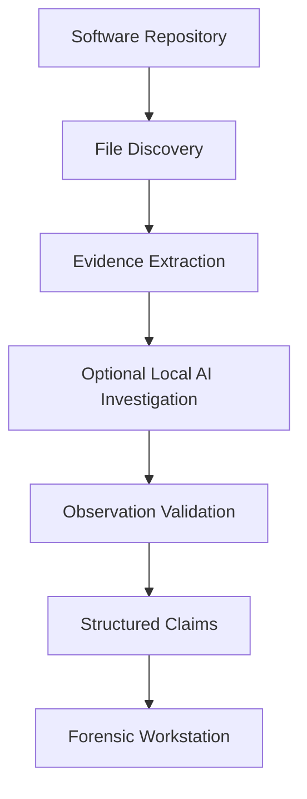
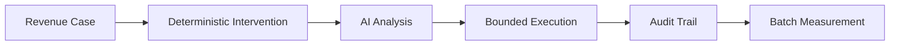
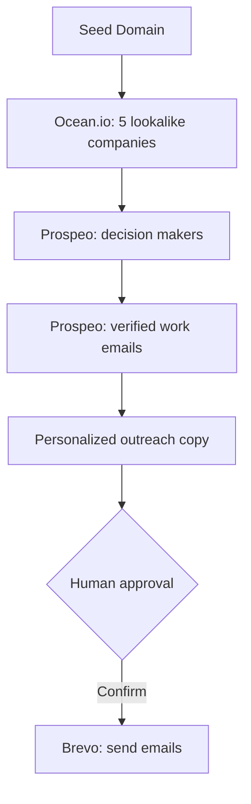
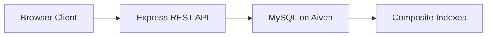
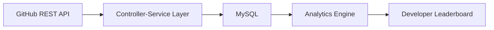
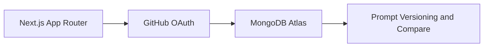

<div align="center">


[](https://github.com/qwerty12-ai)

[](https://github.com/qwerty12-ai)
[](https://linkedin.com/in/mohd-abdul-sabeeh-38429a2ba)
[](mailto:sabeehmohd79@gmail.com)

📍 Hyderabad, India &nbsp;•&nbsp; 🎓 Sreenidhi Institute of Science & Technology (2023–2027)

</div>

---

## 👋 About

I enjoy building software systems with a strong focus on **backend architecture, API design, database optimization, and scalable software design**.

Over the past year I've shipped **4 deployed REST APIs** covering cursor pagination over a 200K-product dataset, multi-API orchestration with graceful degradation, analytics engines, and AI-powered full-stack apps.

- 🛡️ **Reclaim** is a controlled AI revenue recovery system: deterministic recovery logic, AI-assisted analysis, bounded execution, audit trails, idempotency, and batch recovery measurement.
- 🔬 **Knowledge Compiler** (my latest) turns repository artifacts into structured engineering claims linked to extracted evidence, with optional local-LLM investigation. Stack: Python compiler, FastAPI, Redis, BullMQ, MySQL, and a Next.js forensic workstation.

I care about reliable backend systems that are maintainable, scalable, and easy to reason about, and about making AI-generated findings **inspectable** instead of treating plausible explanations as established facts.

**Currently learning:** Docker • AWS • Redis • Cloud Computing • DevOps

> 🏆 Top 25% Nationally, Amazon ML Challenge 2025 &nbsp;|&nbsp; 🎓 CS50x Graduate

---

## 🖥 Developer Console

Welcome to Mohd Abdul Sabeeh's Developer Console. Click ▶ beside a command to run it.

```text
Session initialized.
sabeeh@dev:~$ _
```

<details>
<summary><code>help</code></summary>

```text
sabeeh@dev:~$ help

Available commands

about          Learn about me
projects       Browse featured projects
skills         View technical stack
achievements   Awards & certifications
learning       Current learning roadmap
philosophy     Engineering mindset
contact        Ways to reach me
pwd            Print working directory
git status     Repository status
neofetch       System summary
resume         Career snapshot
exit           Close session

sabeeh@dev:~$ _
```

</details>

<details>
<summary><code>about</code></summary>

```text
sabeeh@dev:~$ about

Mohd Abdul Sabeeh

Backend-Focused Full Stack Developer

Building software systems with a focus on
backend engineering, scalable REST APIs, database
design, system architecture, and AI-powered systems.

Current engineering interests:
- Evidence-backed codebase analysis
- Background job processing
- Database and API design
- Deterministic systems with optional AI
- Containerized application architecture

📍 Hyderabad, India
🎓 B.Tech Computer Science & Engineering
   Sreenidhi Institute of Science & Technology
   2023–2027

Interested in solving real engineering problems,
shipping software, and continuously improving
through hands-on projects.

sabeeh@dev:~$ _
```

</details>

<details>
<summary><code>projects</code></summary>

```text
sabeeh@dev:~$ projects

✓ Knowledge Compiler
  Evidence-backed codebase analysis with a Python
  compiler, optional local AI investigation, claim
  validation, background jobs, and a forensic UI.

✓ Reclaim
  Controlled AI revenue recovery system with
  bounded execution, auditability, escalation,
  idempotency, and batch recovery measurement.

✓ SignalForge
  Multi-API orchestration platform with graceful
  degradation and human approval workflow.

✓ CursorVault
  Cursor pagination REST API handling
  200K+ products efficiently.

✓ GitPulse
  GitHub Developer Analytics Platform with
  relational data modeling and REST APIs.

✓ PromptPad AI
  Prompt engineering workspace featuring GitHub
  OAuth, versioning, and analytics.

sabeeh@dev:~$ _
```

</details>

<details>
<summary><code>skills</code></summary>

```text
sabeeh@dev:~$ skills

Languages        JavaScript, TypeScript, Python, SQL, Bash
Backend          Node.js, Express.js, FastAPI, REST APIs, Background Jobs
Frontend         React, Next.js, Tailwind CSS
Databases        MySQL, MongoDB, Mongoose
AI               Ollama, Qwen 3:4B, AI-Assisted Investigation,
                 Evidence-Based Validation
Infrastructure   Linux, Docker, Docker Compose, Redis, AWS (Learning)
Queues           BullMQ, Redis Pub/Sub, Server-Sent Events
CI/CD & Testing  GitHub Actions, pytest, Frontend Lint & Build Checks
Tools            Git, Postman, Render, Vercel, MongoDB Atlas

sabeeh@dev:~$ _
```

</details>

<details>
<summary><code>achievements</code></summary>

```text
sabeeh@dev:~$ achievements

🏆 Amazon ML Challenge 2025

Ranked 1420 / 5740
Top 25% Nationally

SMAPE
70.5 → 50.5

15 Iterative Model Submissions

🎓 CS50x
Harvard University

sabeeh@dev:~$ _
```

</details>

<details>
<summary><code>learning</code></summary>

```text
sabeeh@dev:~$ learning

Current Roadmap

→ Docker & Containerization
→ Redis & Background Processing
→ AWS & Cloud Computing
→ DevOps & CI/CD
→ System Design
→ Reliable Distributed Systems

Always learning.
Always building.

sabeeh@dev:~$ _
```

</details>

<details>
<summary><code>philosophy</code></summary>

```text
sabeeh@dev:~$ philosophy

Build products,
not tutorials.

Understand systems,
don't memorize frameworks.

Optimize for maintainability
before complexity.

Products over promises.

sabeeh@dev:~$ _
```

</details>

<details>
<summary><code>contact</code></summary>

```text
sabeeh@dev:~$ contact

GitHub
github.com/qwerty12-ai

LinkedIn
linkedin.com/in/mohd-abdul-sabeeh-38429a2ba

Email
sabeehmohd79@gmail.com

sabeeh@dev:~$ _
```

</details>

<details>
<summary><code>pwd</code></summary>

```text
sabeeh@dev:~$ pwd

/home/sabeeh/building-products

sabeeh@dev:~$ _
```

</details>

<details>
<summary><code>git status</code></summary>

```text
sabeeh@dev:~$ git status

On branch main

Your branch is up to date with 'origin/main'.

nothing to commit, working tree clean.

Keep building.

sabeeh@dev:~$ _
```

</details>

<details>
<summary><code>neofetch</code></summary>

```text
sabeeh@dev:~$ neofetch

OS          : Backend Engineer
Host        : Hyderabad, India
Kernel      : B.Tech CSE (2023–2027)
Shell       : bash
Editor      : VS Code
Languages   : JavaScript, TypeScript, Python, SQL
Backend     : Node.js, Express.js, FastAPI
Databases   : MySQL, MongoDB
AI          : Ollama, Qwen 3:4B
Queues      : Redis, BullMQ
Containers  : Docker, Docker Compose
CI/CD       : GitHub Actions
Status      : Building products

sabeeh@dev:~$ _
```

</details>

<details>
<summary><code>resume</code></summary>

```text
sabeeh@dev:~$ resume

Mohd Abdul Sabeeh
-----------------
Role      : Backend-Focused Full Stack Developer
Education : B.Tech CSE (2023–2027)
Location  : Hyderabad, India

Highlights
----------
✓ REST API Design & Backend Engineering
✓ Database Design & Query Optimization
✓ Multi-API Orchestration
✓ AI-Powered Full-Stack Systems
✓ Evidence-Backed Codebase Analysis
✓ Deterministic Analysis & Optional Local AI
✓ Background Jobs with Redis & BullMQ
✓ MySQL Persistence & Data Modeling
✓ Docker Compose & GitHub Actions CI

Resume available in this repository.

sabeeh@dev:~$ _
```

</details>

<details>
<summary><code>exit</code></summary>

```text
sabeeh@dev:~$ exit

logout

Connection to github.com closed.

See you in the next commit.
```

</details>

---

## 🏆 Amazon ML Challenge 2025

<div align="center">

**Smart Product Pricing • Team PrimeVision • Team Lead • Ranked 1420 / 5740 (Top 25%)**

| Metric | Result |
| :--- | :--- |
| 📉 SMAPE Score | **70.5 → 50.5** |
| 🔁 Iterations | 15 submissions |
| 🧠 Model | TF-IDF (1–3 grams) + handcrafted text features + LightGBM, trained on log(price) |
| 🖼 Data used | Text only (`catalog_content`) |

[](https://github.com/qwerty12-ai/AMAZON-ML-CHALLENGE-2025-SOURCE-CODES-FOR-DEMONSTRATION)

</div>

---

## 🚀 Featured Products

### 🔬 Knowledge Compiler

*Show me what this codebase knows about itself.*

Analyzes a software repository and turns it into structured engineering **claims with evidence references**, so findings, supporting evidence, and uncertainty are easy to inspect. The deterministic analysis works without a language model or GPU; local AI investigation is optional.



- Python compiler with repository discovery, file-content extraction, Python AST structural analysis, and structured JSON output.
- Optional local AI investigation (Ollama + Qwen 3:4B) over README docs, Python functions, and classes.
- Validation stage that checks AI observations against independently extracted evidence using a second model call.
- Knowledge model with claim statuses, heuristic confidence scores, evidence references, and claim-evidence relationships.
- FastAPI backend, Redis + BullMQ background jobs with progress events, and MySQL persistence.
- Next.js, React, and TypeScript forensic workstation with a Redis inspector.
- Docker Compose setup and GitHub Actions CI (compiler/backend tests, frontend lint and build).


`BullMQ` `Ollama` `Qwen 3:4B` `pytest`

[](https://github.com/qwerty12-ai/knowledge-compiler)
[](https://drive.google.com/file/d/1MWG1KX5LHnnaEhTZarqZ-3c935FxHzTB/view?usp=sharing)

> **Scope:** Knowledge Compiler is an evolving project. Structural analysis is primarily implemented for Python, deterministic claims cover a limited set of repository properties, AI-based validation is not formal verification, and confidence scores are heuristic rather than calibrated probabilities. The repository is publicly viewable but proprietary (not open source), and the web app currently runs as a local Docker Compose setup rather than a production deployment.

---

### 🛡️ Reclaim

*Controlled AI revenue recovery: detect, analyze, and recover revenue at risk.*

**The app decides. The AI explains. The execution layer enforces the bounds.**



- Deterministic recovery pipeline for payment failures, checkout abandonment, and subscription failures.
- AI-assisted analysis via local Qwen 3:4B through Ollama, exposed as a dedicated FastAPI service.
- Bounded execution with `executed`, `stopped`, and `escalated` outcomes.
- Persistent MySQL audit records plus individual and batch idempotency.
- Batch measurement: revenue at risk, revenue recovered, recovery rate, and outcome counts.
- Three-service Docker Compose stack (Next.js, FastAPI, MySQL) with GitHub Actions CI.


`Ollama` `Qwen 3:4B` `Pydantic`

[](https://github.com/qwerty12-ai/Reclaim)
[](https://drive.google.com/file/d/159puneOEg8M65Fe32Vmyzru-Qh1BiI3H/view?usp=sharing)

> Recovery actions are simulated on seeded cases and are not connected to a real payment processor.

---

### 📡 SignalForge

*One seed domain in. Lookalike companies, decision makers, verified emails, and personalized outreach out, with a human approval step before anything sends.*



- Resilient multi-API orchestration that degrades gracefully on rate limits and empty results.
- Human approval checkpoint: nothing is sent until the user reviews every email.
- Normalization layer for heterogeneous API responses; outreach copy matched back to the correct company.


[](https://github.com/qwerty12-ai/SignalForge)
[](https://drive.google.com/file/d/17i8M8O-Y-4LI37GD4br1zExxyfpkedTQ/view)

> Prospeo runs on credits, so the walkthrough video is the reliable way to see the full pipeline.

---

### ⚡ CursorVault

*Cursor-based pagination API over a 200K-product dataset.*



- Composite indexes on `(updated_at DESC, id DESC)` and `(category, updated_at DESC, id DESC)` for ordered queries.
- Base64 cursor encoding from `updated_at + id` for stable pagination, with `limit + 1` fetching to compute `hasMore` without a `COUNT(*)`.
- Batch-seeded 200,000 rows; Postman collections for local and production.


[](https://cursorvault.onrender.com/api/products?limit=5)
[](https://github.com/qwerty12-ai/CursorVault)

> Hosted on Render's free tier, so the first request after inactivity can take a few seconds to wake up.

---

### 📊 GitPulse

*Developer analytics platform built on the GitHub REST API.*



- Controller-service architecture around the GitHub REST API.
- Normalized one-to-many schema (`users` → `repositories`) with foreign keys and cascading deletes.
- Analytics: total stars and forks, top repository, custom developer score, and a ranked leaderboard.
- Deployed on Railway and verified in production with Postman and HTTP logs.


[](https://github.com/qwerty12-ai/GitPulse)
[](https://youtu.be/fi0XzXL_fIk)
[](https://gitpulse-production-2582.up.railway.app/)

---

### ✍️ PromptPad AI

*A VS Code-style workspace for prompt engineers.*



- GitHub OAuth through NextAuth.js, with per-user prompt isolation.
- Write, edit, and save prompts; compare prompts side by side.
- AI output generation via Puter.js; MongoDB + Mongoose persistence.


[](https://promptpad-ai-editor.vercel.app)
[](https://github.com/qwerty12-ai/PromptPad-AI-Editor)

---

## 💻 Tech Stack

<div align="center">

**Languages**<br/>
<br/>
SQL

**Backend**<br/>


**Frontend**<br/>


**Databases**<br/>


**Infrastructure & CI/CD**<br/>
<br/>
AWS (learning)

**Tools**<br/>


**AI, Queues & Hosting**<br/>
Ollama • Qwen 3:4B • BullMQ • Redis Pub/Sub • Server-Sent Events • pytest • Render • Railway • MongoDB Atlas • Aiven

</div>

---

## 📊 GitHub Stats

<div align="center">


 

</div>

---

## 🎯 Currently Learning

- 🐳 Docker and containerization
- ⚙️ Redis and background job processing
- ☁️ AWS and cloud computing
- 🔁 DevOps and CI/CD
- 🧩 System design
- 🌐 Reliable distributed systems

---

## 🧠 Engineering Philosophy

- Build products, not tutorials.
- Understand systems instead of memorizing frameworks.
- Optimize for maintainability before complexity.
- Show the evidence. Make uncertainty visible.

---

## 🏅 Certifications

**CS50x, Harvard University** &nbsp;[View certificate](https://certificates.cs50.io/b6002d62-50e3-4d0e-9da8-7a70a9bfd722.pdf)

---

## 🔗 Connect

<div align="center">

[](mailto:sabeehmohd79@gmail.com)
[](https://linkedin.com/in/mohd-abdul-sabeeh-38429a2ba)
[](https://github.com/qwerty12-ai)

**Products over promises.**


</div>
